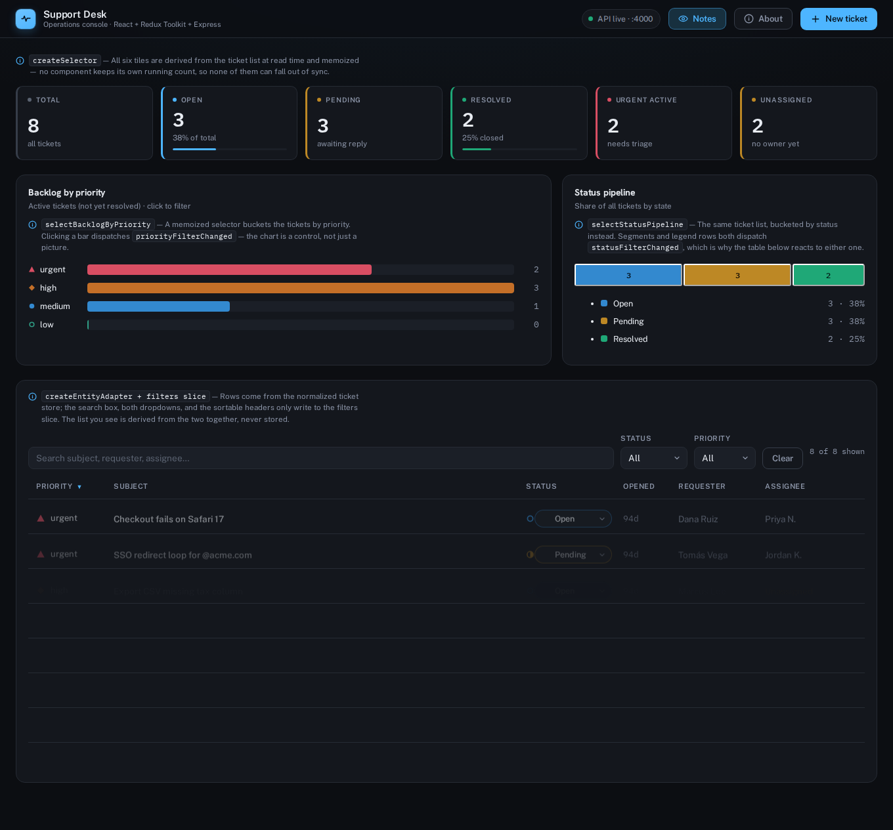
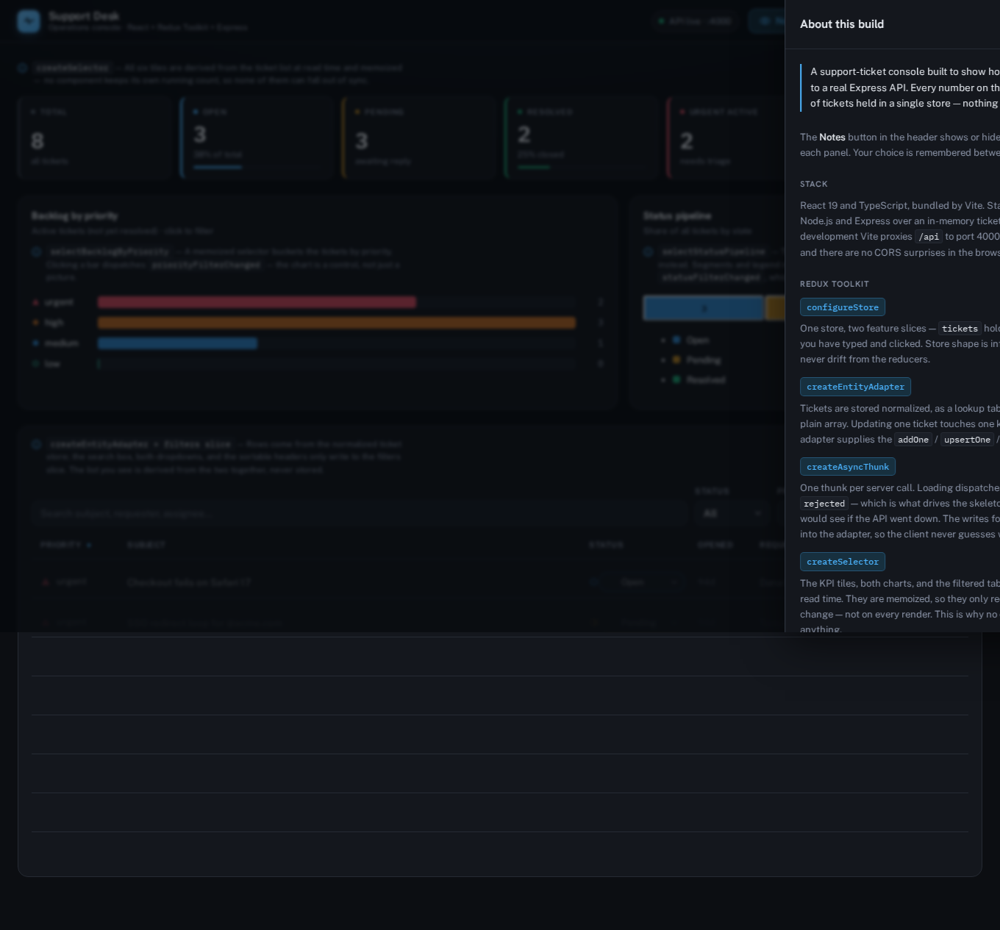
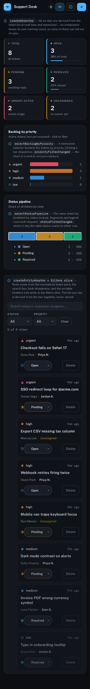

# Support Desk Dashboard — React + Redux Toolkit + Express

[](https://github.com/Vibin-LLC-2025/redux-support-dashboard/actions/workflows/ci.yml)

A small full-stack support-ticket dashboard built to demonstrate production patterns in
**Redux Toolkit** on the front end and a **Node.js / Express** REST API on the back end.

> One store, one source of truth. KPIs, charts, and rows are all derived from the same normalized ticket list — no duplicated state in components.

## Screenshots

<p align="center">
  
</p>

<p align="center">
  
</p>

<p align="center">
  
</p>

## Highlights

**Redux Toolkit (client)**
- `configureStore` with two feature slices (`tickets`, `filters`) and typed hooks.
- `createEntityAdapter` for normalized ticket state + generated selectors.
- `createAsyncThunk` for every server call (load / create / update / delete) with
  `pending` / `fulfilled` / `rejected` handling in `extraReducers`.
- `createSelector` memoized selectors that derive the KPI cards and the
  filtered + sorted table from raw state — the UI holds no derived data of its own.

**Express (server)**
- A REST API (`GET` / `POST` / `PATCH` / `DELETE`) over an in-memory ticket store.
- `express.json()` body parsing, CORS, request logging, input validation, and
  realistic status codes (`201`, `404`, `400`).

**Data-heavy UI**
- KPI stat cards, a sortable + filterable ticket table, and inline status editing —
  all state driven through Redux.

## Testing and accessibility

- Vitest runs in a browser-like `jsdom` environment so DOM APIs and `localStorage` exist.
- Added round-trip tests for the one persisted preference (read at store creation, mirrored back via listener middleware).
- Component code follows "no color-alone" for data encoding; prior audits reported 0 axe violations.

## Run it

Two terminals (or `npm run dev` from the root to run both):

```bash
# terminal 1 — API on http://localhost:4000
cd server && npm install && npm start

# terminal 2 — app on http://localhost:5173 (proxies /api to the server)
cd client && npm install && npm run dev
```

Root convenience:

```bash
npm install         # installs concurrently
npm run dev         # runs server + client together
```

Optional: regenerate screenshots locally

```bash
npm run screenshots
```

## Layout

```
server/                 Express REST API
  server.js             app, routes, validation, in-memory store
client/
  src/
    app/store.ts        configureStore + RootState/AppDispatch types
    app/hooks.ts        typed useAppDispatch / useAppSelector
    features/tickets/   entity adapter, async thunks, table, forms
    features/filters/   UI filter/sort slice
    features/stats/     KPI cards
    selectors.ts        memoized derived state (KPIs, filtered+sorted list)
```

## What I'd do next

- Add eslint + prettier with a focused rule set and a few plugin checks (jsx-a11y).
- Convert the focus-trap in `components/SlideOver.tsx` to be resilient to changing `onClose` identities.
- Add a small Playwright smoke (load → toggle filters → create ticket → delete ticket) and publish traces.

